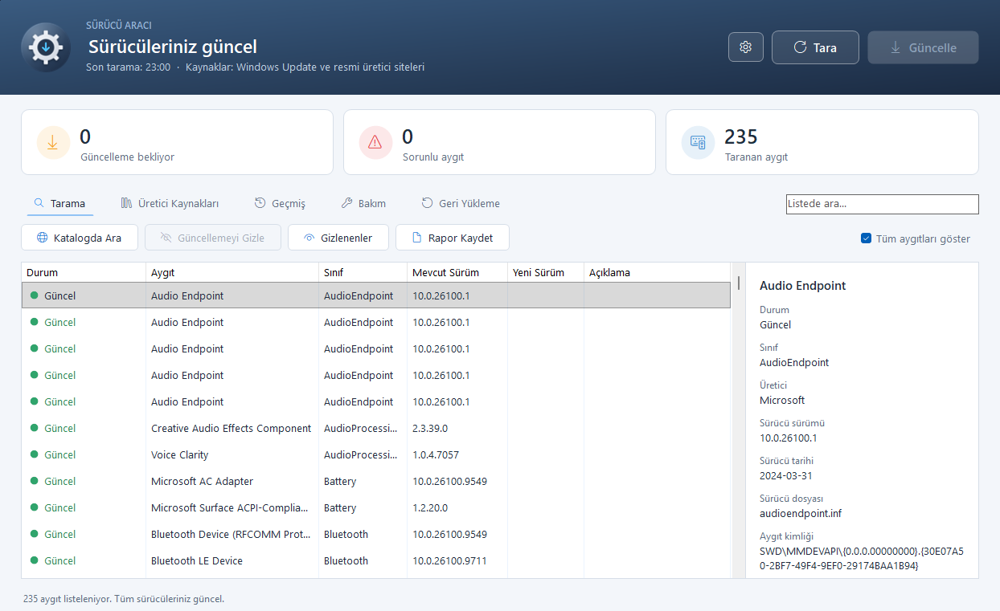
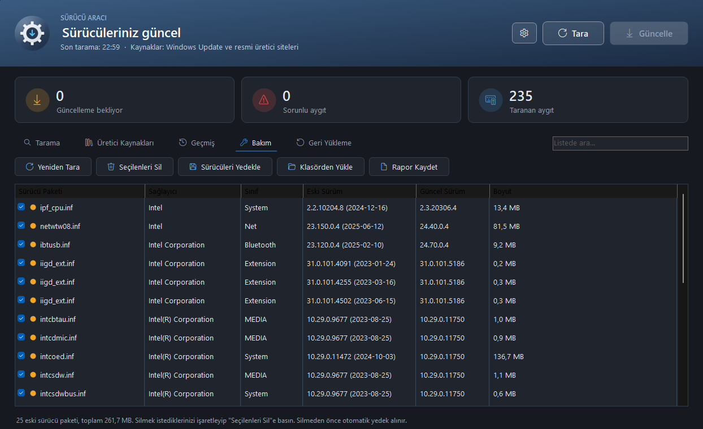

<p align="center">
  
</p>

<h1 align="center">Sürücü Aracı</h1>

<p align="center">
  Windows sürücülerinizi <b>yalnızca resmi kaynaklardan</b> tarayan, güncelleyen ve bakımını yapan ücretsiz bir araç.<br>
  Reklam yok, ek yazılım yok, bilinmeyen kaynaklı sürücü yok.
</p>

<p align="center">
  <a href="../../releases/latest"><b>⬇ Son sürümü indir</b></a> · <a href="#english">English</a>
</p>



## Neden?

IObit Driver Booster veya DriverPack gibi programlar sürücüleri kendi arşivlerinden indirir; reklam ve ek yazılım
dağıtır, dizüstü bilgisayarlara bazen yanlış sürücü kurar. Sürücü Aracı aynı kolaylığı sunar ama sürücüleri yalnızca
**Microsoft'tan (Windows Update ve Microsoft Update Kataloğu)** ve **donanım üreticilerinin kendi sitelerinden** alır.

## Özellikler

- **Format sonrası kurulum** – Windows yeniden kurulunca tek düğmeyle bütün sürücüleri en yeni resmi sürümlerine getirir (Windows Update'in isteğe bağlı sürücüleri, NVIDIA, Intel aracı, üretici sayfası)
- **Tek tıkla tarama** – sorunlu aygıtlar, güncellemesi olan sürücüler ve tüm aygıtlar tek listede
- **Güvenli güncelleme** – kurmadan önce otomatik sistem geri yükleme noktası ve eski sürücülerin yedeği
- **Aygıt onarımı** – sorunlu aygıtı yeniden başlatır, sürücüsünü yeniden yükler veya etkinleştirir
- **Sistem sağlığı** – pil ve disk sağlığı, donanım özeti, mavi ekran ve beklenmedik kapanma geçmişi
- **Arka planda kontrol** – sistem tepsisinde çalışır, günlük veya haftalık kontrol eder, güncelleme bulunca bildirim gösterir
- **Güncellemeyi gizle** – istemediğiniz bir güncellemeyi gizler; Windows Update de onu otomatik kurmaz
- **Microsoft Update Kataloğu** – sürücüsü bulunamayan aygıtları donanım kimliğiyle Microsoft'un arşivinde arar
- **Program güncellemeleri** – Chrome, Discord, Steam gibi kurulu programların güncellemelerini bulur ve tek tıkla kurar (winget)
- **NVIDIA sürücüsü** – ekran kartınız için NVIDIA'nın en yeni sürücüsünü denetler, resmi kurulum programını indirip imzasını doğrulayarak açar
- **Üretici kaynakları** – NVIDIA, AMD, Intel ve bilgisayar üreticinizin resmi sayfaları; Intel aracını tek tıkla kurar (winget)
- **Bakım** – hiçbir aygıtın kullanmadığı eski sürücü sürümlerini bulur ve yedekleyerek temizler
- **Geri yükleme noktaları** – listeler, yenisini oluşturur, bilgisayarı seçilen noktaya döndürür
- **Sürücü yedekleme** – tüm sürücüleri yedekler; Windows'u yeniden kurunca klasörden geri yükler
- **Otomatik koruma** – her hafta geri yükleme noktası, her ay sürücü yedeği (program kapalıyken de)
- **Disk temizliği** – geçici dosyalar, Windows Update önbelleği, hata raporları, Geri Dönüşüm Kutusu
- **Başlangıç programları** – Windows açılışında başlayan programları açıp kapatır (Görev Yöneticisi'yle aynı yöntem)
- **Pil sağlığı geçmişi** – pil kapasitesinin zamanla değişimini grafikle gösterir
- **İşlem geçmişi** – hangi sürücünün ne zaman neyle değiştiğini kaydeder
- **Ayrıntı paneli, arama, HTML rapor**
- **Kendi kendini güncelleme** – yeni sürüm çıkınca haber verir, GitHub'dan indirip doğrulayarak kurar
- **Açık / koyu tema**, **Türkçe / İngilizce**



## Kurulum

1. [Releases](../../releases/latest) sayfasından **SurucuAraciKurulum.exe** dosyasını indirin.
2. Çalıştırıp **Kur**'a basın. Yönetici yetkisi gerekmez; program kullanıcı klasörünüze kurulur.
3. Kaldırmak için: **Ayarlar → Uygulamalar → Sürücü Aracı → Kaldır**.

Kurulum istemiyorsanız **SurucuAraci.exe** dosyasını indirip doğrudan çalıştırabilirsiniz.
Sessiz kurulum için: `SurucuAraciKurulum.exe /sessiz`

> Program dijital olarak imzalı olmadığı için ilk açılışta *"Windows bilgisayarınızı korudu"* uyarısı çıkabilir.
> **Ek bilgi → Yine de çalıştır** ile açabilirsiniz. Kaynak kodun tamamı bu depodadır.

**Gereksinimler:** Windows 10 veya 11 (içinde gelen .NET Framework 4.8 yeterlidir). Güncelleme kurma, temizlik ve
geri yükleme işlemleri yönetici yetkisi ister; program gerektiğinde kendisi sorar.

## Kaynaktan derleme

Ek bir araç gerekmez; Windows'un kendi C# derleyicisi kullanılır:

```bat
derle.bat
```

`SurucuAraci.exe` (program) ve `SurucuAraciKurulum.exe` (kurulum dosyası) oluşur.

| Dosya | İçerik |
|---|---|
| `Program.cs` | Başlangıç, tek kopya çalışma, kaldırma |
| `AnaForm.cs` | Ana pencere, sekmeler, sistem tepsisi |
| `AyarlarFormu.cs` | Ayarlar penceresi |
| `Sistem.cs` | Tarama, Windows Update, yedekleme, temizlik, geri yükleme, onarım, sistem sağlığı |
| `Guncelleyici.cs` | Programın kendi yeni sürümünü denetleme ve kurma |
| `Bakim.cs` | Otomatik koruma görevi, disk temizliği, başlangıç programları, pil geçmişi |
| `Veri.cs` | Ayarlar ve işlem geçmişi |
| `Gorunum.cs` | Tema ve özel çizilen kontroller |
| `Kurulum.cs` | Kurulum programı |

### Yeni sürüm yayınlama

GitHub Actions her gönderide programı derler. Yeni sürüm için:

1. `Ortak.cs` içindeki `Surum` değerini artırın (örneğin `2.2`) ve `surum-notlari.md` dosyasını güncelleyin.
2. Aynı numarayla bir etiket gönderin: `git tag v2.2` ve `git push origin v2.2`.

Actions programı derler ve Releases sayfasında yayınlar; programı kullananlara yeni sürüm otomatik haber verilir.
winget paketini güncellemek için `winget/README.md` dosyasına bakın.

## Lisans

[MIT](LICENSE)

---

<a id="english"></a>

## English

**Sürücü Aracı (Driver Tool)** scans, updates and maintains your Windows drivers using **official sources only**:
Windows Update, the Microsoft Update Catalog and hardware manufacturers' own sites. No ads, no bundled software,
no drivers from unknown archives.

**Features:** one-click post-install setup after reinstalling Windows · one-click scan · program updates (Chrome, Discord, Steam… via winget) · NVIDIA driver check and install · safe updates with an automatic restore point and driver backup · device repair (restart,
reinstall driver, enable) · system health (battery, disks, blue screen history) · self-update from GitHub · background checks with
notifications from the system tray · hide unwanted updates (Windows Update won't install them either) · Microsoft
Update Catalog search by hardware ID · manufacturer tools (NVIDIA, AMD, Intel, PC maker) · old driver cleanup ·
restore point management · driver backup and restore · action history · details panel, search, HTML report ·
light/dark theme · Turkish/English.

**Install:** download **SurucuAraciKurulum.exe** from [Releases](../../releases/latest) and press *Install* (no admin
rights needed; `/sessiz` for a silent install). Uninstall from *Settings → Apps*. Requires Windows 10 or 11. The language can be changed in the
program's settings.

**Build:** run `derle.bat`; it uses the C# compiler that ships with Windows.
